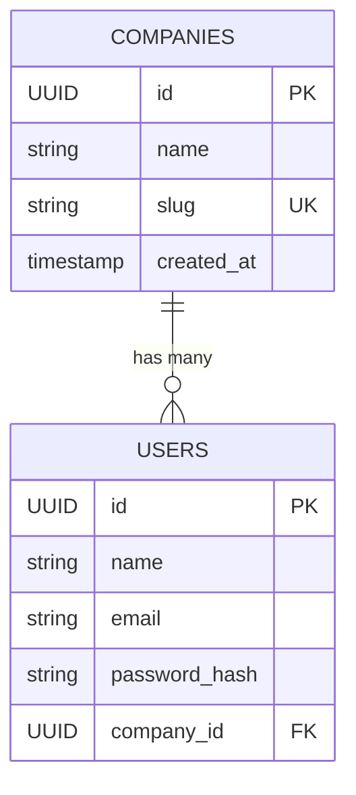

# Cognara — Architecture

## System Overview

Cognara is a multi-tenant AI knowledge and customer-support platform.
The backend is a Spring Boot application structured around domain-driven feature packages with tenant-isolation built into data model constraints.

```
[HTTP Client]
     │
     ▼
[Spring Boot App :8080]
  ├── /api/health       ← Health check
  ├── /api/companies/** ← Company registration & lookup
  └── /actuator/**      ← Spring Boot Actuator (health, info)
     │
     ▼
[PostgreSQL]
  ├── companies (tenants)
  └── users (tenant-scoped membership)
```

---

## Backend Package Structure

```
com.cognara
├── CognaraApplication.java         # Entry point (@SpringBootApplication)
├── common/
│   └── exception/                  # Global error handling and unified error DTOs
│       ├── ApiErrorResponse.java
│       ├── DuplicateResourceException.java
│       ├── ResourceNotFoundException.java
│       └── GlobalExceptionHandler.java
├── config/                         # App-wide Spring configuration beans
├── company/
│   ├── Company.java                # Tenant organization entity (@Entity)
│   ├── CompanyController.java      # REST endpoints (@RestController)
│   ├── service/
│   │   └── CompanyService.java     # Business logic & uniqueness (@Service)
│   ├── repository/
│   │   └── CompanyRepository.java  # Data persistence interface (@Repository)
│   └── dto/
│       ├── CreateCompanyRequest.java
│       └── CompanyResponse.java
├── health/
│   └── HealthController.java       # GET /api/health (@RestController)
└── user/
    ├── User.java                   # User entity with company FK (@Entity)
    ├── repository/
    │   └── UserRepository.java     # Tenant-scoped queries (@Repository)
    ├── service/                    # Future user management services
    └── dto/                        # Future user request & response DTOs
```

**Conventions & Annotations:**
- **Entry point**: `@SpringBootApplication` enables component scanning, auto-configuration, and configuration bean registration.
- **Controllers (`@RestController`)**: Handles HTTP requests (`@GetMapping`, `@PostMapping`), input validation (`@Valid`, `@RequestBody`, `@PathVariable`), and returns DTO responses wrapped in `ResponseEntity`.
- **Services (`@Service`)**: Encapsulates business logic, domain validation rules, and transaction boundaries (`@Transactional`).
- **Repositories (`@Repository`)**: Extends Spring Data `JpaRepository<Entity, ID>` for automatic query generation and persistence.
- **Entities (`@Entity`)**: Maps relational database tables (`@Table`), primary keys (`@Id`, `@GeneratedValue`), and foreign relationships (`@ManyToOne`).
- **DTOs (`record`)**: Request and response data transfer objects. Keeps API contracts isolated from internal entity representations and prevents leaking sensitive attributes (e.g. password hashes).
- **Dependency Injection**: Strict constructor injection on all components for immutability, testability, and clean dependency visibility.
- **Health check**: Standalone `@RestController` returning a lightweight JSON ping directly without unnecessary abstractions.

---

## Database Entities & Relationships

### `companies` (Tenants)
| Column | Type | Constraints | Description |
|--------|------|-------------|-------------|
| `id` | `UUID` | Primary Key | Generated UUID |
| `name` | `VARCHAR(100)` | Not Null | Display name of the tenant |
| `slug` | `VARCHAR(100)` | Unique, Not Null | URL-safe tenant identifier (e.g. `acme-corp`) |
| `created_at` | `TIMESTAMP WITH TIME ZONE` | Not Null | Creation timestamp |

### `users`
| Column | Type | Constraints | Description |
|--------|------|-------------|-------------|
| `id` | `UUID` | Primary Key | Generated UUID |
| `name` | `VARCHAR(100)` | Not Null | User full name |
| `email` | `VARCHAR(150)` | Not Null | User email address |
| `password_hash` | `VARCHAR(255)` | Not Null | Hashed password (never exposed) |
| `company_id` | `UUID` | Foreign Key (companies.id), Not Null | Owning company/tenant |

**Unique Constraint on `users`:**
- `uk_users_company_email (company_id, email)`: Email is unique **per company**, permitting identical emails across separate tenant organizations.



---

## API & Request Flows

### Implemented Endpoints

| Method | Path | Request Body | Response | Status | Description |
|--------|------|--------------|----------|--------|-------------|
| GET | `/api/health` | None | JSON ping | 200 | Application liveness ping |
| GET | `/actuator/health` | None | Actuator health | 200/503 | Actuator health including DB status |
| POST | `/api/companies` | `CreateCompanyRequest` | `CompanyResponse` | 201 Created | Creates a new tenant organization |
| GET | `/api/companies/{id}` | None | `CompanyResponse` | 200 OK | Fetches company by UUID |

### Company Creation Request Flow
```
Client
  │  POST /api/companies { name, slug }
  ▼
CompanyController
  │  @Valid triggers Jakarta Bean Validation
  ▼
CompanyService
  │  Checks companyRepository.existsBySlug(slug)
  │  ├── Duplicate found ──► throws DuplicateResourceException ──► 409 Conflict
  │  └── Unique ───────────► companyRepository.save(company) ──► 201 Created (with Location header)
```

---

## Security & Tenant Isolation Design

### Implemented in Milestone 2:
- **Composite Uniqueness:** `users` table enforces tenant-scoped uniqueness `(company_id, email)` instead of global email uniqueness.
- **Repository Scoping:** `UserRepository` explicitly scopes user queries by `companyId` (e.g., `findByCompanyIdAndEmail`, `findByCompanyId`).
- **Credential Protection:** `passwordHash` is stored on `User` but excluded from DTOs. `CompanyResponse` exposes only non-sensitive company metadata.
- **Input Validation:** Slugs must adhere to lowercase hyphenated format (`^[a-z0-9]+(?:-[a-z0-9]+)*$`).

### Current Boundary Limitation:
- **Tenant isolation is not yet fully enforced at the network/auth layer.** Until JWT authentication and tenant context resolvers are added in a future milestone, cross-tenant isolation is enforced at the data model and repository level, not by public authorization guards.

---

## External Integrations

None in Milestone 2.

---

## Architectural Decisions

| Decision | Rationale |
|----------|-----------|
| UUID Primary Keys | Avoids predictable sequential IDs, preventing enumeration attacks across tenants. |
| Tenant-Scoped Email (`company_id, email`) | Core multi-tenant principle: different companies can have users with the same email without collisions. |
| GlobalExceptionHandler (`@RestControllerAdvice`) | Unified `ApiErrorResponse` format across validation errors (400), not-found (404), and conflicts (409). |
| Spring Boot 3.5.3 + Java 21 | Uses verified stable dependencies compatible with local JDK 25 and cached distribution. |
| Maven Wrapper (`mvnw.cmd`) | Self-contained build script so developers don't need Maven installed globally or on PATH. |
| In-Memory H2 for Test Slices | `@ActiveProfiles("test")` runs repository tests against H2 with `create-drop` without needing live PostgreSQL running during automated builds. |
| `ddl-auto=validate` for Dev/Prod | Prevents accidental schema modifications; production databases will use Flyway migrations. |
